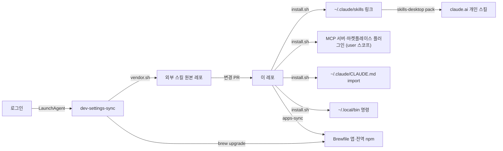

# my-dev-settings

맥마다 맞춰 두는 개발 환경 설정: Claude Code 스킬·MCP·마켓플레이스 플러그인, 전역 CLAUDE.md, 설치 앱 목록(`apps/Brewfile`), 전역 npm 패키지(`apps/npm-globals`).

새 맥에서는 `install.sh` 한 번과 `apps-sync` 한 번이면 같은 환경이 됩니다. 이후에는 `git pull`과 로그인 때 도는 `dev-settings-sync`가 맥끼리 맞춰 줍니다.

## 한눈에 보기



## 목차

- [한눈에 보기](#한눈에-보기)
- [레포 구조](#레포-구조)
- [설치와 업데이트](#설치와-업데이트)
- [명령어](#명령어)
- [자동 동기화](#자동-동기화)
- [Claude Code 스킬](#claude-code-스킬)
  - [주기적으로 점검할 스킬](#주기적으로-점검할-스킬)
  - [플러그인 목록](#플러그인-목록)
  - [외부 스킬 업데이트·추가](#외부-스킬-업데이트추가)
  - [플러그인으로 설치하는 방법(대안)](#플러그인으로-설치하는-방법대안)
- [MCP 서버](#mcp-서버)
- [마켓플레이스 플러그인](#마켓플레이스-플러그인)
- [daily-log](#daily-log)
- [앱 맞추기](#앱-맞추기)
- [Claude 데스크톱 업로드](#claude-데스크톱-업로드)
- [전역 CLAUDE.md](#전역-claudemd)
- [이름 변경 후 옮기기](#이름-변경-후-옮기기)
- [문제 해결](#문제-해결)
- [되돌리기](#되돌리기)
- [스크립트 고치기와 테스트](#스크립트-고치기와-테스트)

## 레포 구조

```text
install.sh              맥 설정 전체(스킬 링크, MCP, 플러그인, CLAUDE.md, 훅, LaunchAgent). 단계별 함수, 맨 아래 main
vendor.sh               외부 스킬을 원본 레포에서 다시 받아 plugins/·docs/upstream/·mcp/를 갱신
skills-exclude          전역 링크에서 뺄 플러그인과 예외(!플러그인/스킬)
global-claude.md        모든 프로젝트에 적용할 공통 지시(~/.claude/CLAUDE.md가 import)
bin/                    ~/.local/bin에 링크되는 명령(apps-sync, dev-settings-sync, skills-ls, skills-desktop, rmbg)
plugins/<플러그인>/      스킬 묶음. 직접 만든 것과 외부에서 벤더링한 것이 섞여 있음(아래 '플러그인 목록'의 출처 열)
mcp/financial-datasets/ 벤더링한 MCP 서버
apps/                   Brewfile, npm-globals, manual.md(설치 도구로 못 까는 앱)
docs/skills/            플러그인별 사용 문서(scripts/gen-skill-docs.py가 GENERATED 아래를 다시 만듦)
docs/upstream/          외부 레포의 사용 문서 원문(vendor.sh가 복사)
scripts/                문서 생성 스크립트
tests/                  install.sh 테스트(가짜 HOME과 가짜 claude·gh·launchctl로 실행)
.claude-plugin/         플러그인 방식 설치용 마켓플레이스 정의
```

외부에서 벤더링한 파일(`plugins/`의 외부 플러그인, `mcp/`, `docs/upstream/`)은 손으로 고치지 않습니다. `vendor.sh`가 다음 동기화 때 원본으로 덮어씁니다. 바꿀 것이 있으면 `vendor.sh` 안의 후처리(이름 접두어, preamble 끼워 넣기 등)로 합니다.

## 설치와 업데이트

필요한 것: macOS, Homebrew, GitHub CLI(`brew install gh && gh auth login`), Python 3(macOS 기본, 외부 패키지 없음), uv(code-review-graph MCP·nlm용), Node.js(oh-my-claudecode·career-ops 플러그인용), Claude Code CLI. android-reverse-engineering에는 Java·jadx 등이 더 필요합니다. Homebrew 말고는 모두 Brewfile에 있어 `apps-sync`로 설치됩니다(Java는 jadx 의존성으로 함께 들어옴). Claude CLI가 없을 때 `install.sh`는 MCP·플러그인 단계만 건너뛰고 나머지를 마치므로, `apps-sync` 뒤에 `install.sh`를 한 번 더 돌리면 됩니다.

```bash
git clone https://github.com/HerrineKim/my-dev-settings.git ~/Projects/my-dev-settings
~/Projects/my-dev-settings/install.sh   # 쓰는 맥마다 한 번
apps-sync                               # 앱 설치(아래 '앱 맞추기')
```

업데이트는 `git -C ~/Projects/my-dev-settings pull`. 스킬은 심볼릭 링크라 바로 반영됩니다. 로그인할 때마다 brew와 외부 스킬도 자동으로 갱신합니다(아래 '자동 동기화').

`install.sh`가 하는 일(여러 번 실행해도 안전)
- `plugins/*/skills/*`를 `~/.claude/skills`에 링크(`/<스킬 이름>`으로 호출). 레포에서 빠진 스킬의 끊어진 링크는 지움. `skills-exclude`에 적은 플러그인은 링크하지 않고 이미 걸린 링크도 뺌(레포에는 그대로 있어 줄을 지우면 돌아옴). `!플러그인/스킬` 줄은 뺀 플러그인 안에서 그 스킬만 링크
- `bin/`의 `skills-ls`, `skills-desktop`, `apps-sync`, `rmbg`, `dev-settings-sync`를 `~/.local/bin`에 링크
- 로그인할 때마다 `dev-settings-sync`를 한 번 실행하는 LaunchAgent 등록(아래 '자동 동기화')
- `~/.claude/CLAUDE.md` 끝에 `global-claude.md`를 불러오는 블록 추가(아래 '전역 CLAUDE.md')
- MCP 서버 `code-review-graph`, `korean-law`, `front-end-checklist`를 user 스코프로 등록. `/pdf-to-wiki`용 `nlm` CLI를 `uv tool install notebooklm-mcp-cli`로 받고 `gemini-notebook-mcp`를 등록(로그인 `nlm login`은 직접). `financial-datasets`, `figma-bridge`도 등록(아래 'MCP 서버'). `korean-law`는 `skills-exclude`에 있을 때, `front-end-checklist`는 `frontend-checklist-global`을 전역 링크하지 않을 때 등록하지 않고, 이미 등록돼 있으면 지움
- 외부 마켓플레이스 플러그인 `oh-my-claudecode`, `vercel`, `figma`, `frontend-design`, `career-ops`를 user 스코프로 설치(아래 '마켓플레이스 플러그인')
- `/daily-log`용 훅 등록과 iCloud Drive 공유 폴더 생성(아래 'daily-log')
- 예전 이름(`my-claude-skills`)으로 받아 둔 레포의 git remote를 새 주소로 바꿈(아래 '이름 변경 후 옮기기')

`!`로 시작하는 줄은 직접 할 일입니다(아래 '문제 해결').

## 명령어

`install.sh`가 `bin/`의 명령을 `~/.local/bin`에 링크합니다. `apps-sync`는 아래 '앱 맞추기', `dev-settings-sync`는 '자동 동기화'에 있습니다.

```bash
skills-ls            # 전역 스킬 전체: ~/.claude/skills, claude.ai 동기화 스킬, user 플러그인 스킬
skills-ls supabase   # 이름·설명에 키워드가 들어간 것만
```

`rmbg`는 이미지 배경을 지웁니다. 전역 npm `@imgly/background-removal-node`를 부르고, 모델이 패키지에 들어 있어 오프라인에서도 동작합니다.

```bash
rmbg photo.jpg                          # photo-nobg.png 를 같은 폴더에
rmbg *.jpg --out cut --format webp      # 여러 장을 cut/ 에 webp로
rmbg photo.jpg --type mask --model small  # 마스크만, 작은 모델로 빠르게
```

## 자동 동기화

`install.sh`가 LaunchAgent(`com.herrinekim.my-dev-settings.sync`)를 등록해, 로그인할 때마다 `dev-settings-sync --boot`가 한 번 돕니다.

1. 네트워크가 잡힐 때까지 기다린 뒤 `brew update && brew upgrade`
2. 레포가 변경 없는 `main`이면 `git pull --ff-only` 후 `vendor.sh`. 바뀐 게 있으면 `chore/vendor-update-<날짜>` 브랜치에 커밋하고 `main`으로 돌아온 뒤, 브랜치를 push하고 `gh`로 PR을 엶. push나 PR이 실패하면 커밋은 로컬 브랜치에 남으니 직접 올림
3. Brewfile에 없는 설치 앱이 있으면 알려 줌

레포가 다른 브랜치에 있거나 커밋하지 않은 변경이 있으면 2번은 건너뜁니다. 결과는 macOS 알림과 `~/Library/Logs/my-dev-settings/`에 남습니다.

```bash
dev-settings-sync                                                     # 지금 한 번 실행
launchctl bootout gui/$(id -u)/com.herrinekim.my-dev-settings.sync    # 자동 실행 끄기(install.sh를 다시 돌리면 켜짐)
```

## Claude Code 스킬

스킬별 준비물·호출법·사용 예·원조 GitHub 링크는 [`docs/skills/`](docs/skills/README.md)에 플러그인별로 있습니다. 외부 레포의 사용 문서 원문은 `docs/upstream/`에 있습니다.

### 주기적으로 점검할 스킬

코드베이스를 정기적으로(릴리스 전, 의존성·설정 변경 후, 커밋·PR 전) 훑을 때 쓰는 스킬 모음입니다. 사용자나 에이전트가 체크리스트로 써도 됩니다. 공격·침투 성격의 스킬은 본인이 소유했거나 서면으로 허가받은 대상에만 씁니다(아래 `cybersecurity` 설명 참고).

| 스킬 | 언제·어떻게 |
|---|---|
| `/security-review` (Claude Code 기본) | 커밋·PR 전 변경분의 취약점·시크릿 노출을 훑을 때 |
| `/code-review` (Claude Code 기본) | PR 전 변경분의 버그·품질 리뷰. 깊게 볼 때 `/code-review ultra` |
| `/02-vulnerability-scanner` | 의존성 추가·릴리스 전 의존성·CVE·설정(하드코딩 시크릿 포함) 점검 |
| `/20-supply-chain-security` | 새 패키지·락파일 변경 후 타이포스쿼팅·악성 패키지·CI 훅 점검 |
| `/09-web-security` | 웹·API 핸들러 변경 시 OWASP Top 10 관점 점검 |
| `/10-cloud-security` | Terraform·IaC·쿠버네티스 매니페스트 변경 시 설정 미스 점검 |
| `/13-crypto-analysis` | 배포 환경 TLS 엔드포인트·암호화 코드 정기 점검 |
| `/review-changes`·`/review-pr` (code-review-graph) | 큰 변경을 영향 범위 중심으로 리뷰. 프로젝트마다 `/build-graph` 먼저 |
| `/web-design-guidelines` | UI 코드 변경 시 접근성·인터페이스 가이드라인 점검 |
| `/frontend-checklist-global` | 출시 전 페이지·컴포넌트를 Front-End Checklist 규칙(접근성·성능·SEO·보안)으로 감사. 공개 URL은 `audit_url` |
| `/antislop-code` | 커밋 전 생성·수정 코드의 뻔한 AI 주석만 정리(코드는 안 건드림) |
| `/karpathy-guidelines` | LLM이 만든 코드의 가정·단순함·수정 범위·검증 기준 점검 |

### 플러그인 목록

괄호 안 숫자는 플러그인에 든 스킬 수입니다.

| 플러그인 | 내용 | 출처 |
|---|---|---|
| `daily-log` (2) | `/daily-log`: 오늘 Claude Code 작업과 GitHub 반영 내역을 노션 업무 회고에 기록. `/erp-clock-out`: ERP MCP로 퇴근을 찍으며 업무별 일지와 PR·커밋·티켓 링크를 남김(ERP MCP 서버 `erp`가 등록돼 있어야 함) | 직접 만듦 |
| `tdd-tidy-first` | Kent Beck식 TDD + Tidy First(plan.md "go" 워크플로) | 직접 만듦 |
| `riverlog-knowledge` | 새 작업(개발·디자인·리뷰·문서·글쓰기·조사) 전에 [riverlog](https://github.com/HerrineKim/riverlog) 지식 창고 노트 참고. 로컬 사본이 없으면 `~/.cache/riverlog`로 받음 | 직접 만듦 |
| `figma-artifact-import` | HTML 프로토타입 화면 수십~수백 개를 Figma MCP로 편집 가능한 레이어로 옮김 | 직접 만듦 |
| `ui-polish` | 설치된 UI 스킬(공식 플러그인 frontend-design·antislop·make-interfaces-feel-better·web-design-guidelines)을 순서대로 불러 UI 개선을 한 번에. `--review`·`--quick` 모드 | 직접 만듦 |
| `note` | 자료(글·URL·파일)를 riverlog 노트로 재구성해 넣고 인덱스·링크 갱신. `~/Projects/riverlog`(또는 `$RIVERLOG_DIR`) | [HerrineKim/riverlog](https://github.com/HerrineKim/riverlog/tree/main/.claude/skills/note). 벤더링 때 `plugins/note/global-preamble.md`(레포 위치 찾기)를 앞에 끼워 넣음 |
| `ui-ux-pro-max` (7) | UI/UX 판단 데이터와 `/ui-styling`, `/design`, `/design-system`, `/brand`, `/banner-design`, `/slides` | [nextlevelbuilder/ui-ux-pro-max-skill](https://github.com/nextlevelbuilder/ui-ux-pro-max-skill) |
| `web-design-guidelines` | Vercel Web Interface Guidelines로 UI 코드 리뷰 | [vercel-labs/agent-skills](https://github.com/vercel-labs/agent-skills) |
| `make-interfaces-feel-better` | 애니메이션·그림자·타이포·아이콘 등 UI 디테일 원칙 | [jakubkrehel/make-interfaces-feel-better](https://github.com/jakubkrehel/make-interfaces-feel-better) (MIT) |
| `clone-website` | URL을 Next.js + shadcn/ui + Tailwind로 픽셀 단위 복제. 브라우저 MCP 필요 | [julianromli/ai-skills](https://github.com/julianromli/ai-skills/tree/main/skills/clone-website) |
| `diagram-design` | 아키텍처·플로차트·시퀀스·ERD 등 40여 종 다이어그램(HTML/SVG/PNG), drawio·Mermaid·excalidraw 가져오기 | [cathrynlavery/diagram-design](https://github.com/cathrynlavery/diagram-design) (MIT) |
| `antislop` (6) | 생성 결과의 뻔한 AI 티 필터(UI·카피·코드 주석·접근성·반응형). 걸러내기만 하고 스타일은 정하지 않음 | [miqdadbadjuber/anti-slop](https://github.com/miqdadbadjuber/anti-slop) (MIT). 대비 검사 MCP 서버는 뺌 |
| `ai-slop-thresher` (2) | 한국어 초안 윤문. `/thresh`는 직접 불렀을 때만 동작하는 단축 호출 | [Burntgogi/ai-slop-thresher](https://github.com/Burntgogi/ai-slop-thresher) (Apache-2.0) |
| `karpathy-guidelines` | LLM 코딩 실수를 줄이는 지침(가정 드러내기·단순함·필요한 줄만 수정·검증 기준) | [multica-ai/andrej-karpathy-skills](https://github.com/multica-ai/andrej-karpathy-skills) (MIT) |
| `code-review-graph` (7) | 코드 그래프(MCP)로 변경 영향 범위만 읽는 리뷰·디버깅. 프로젝트마다 `/build-graph` 먼저 | [tirth8205/code-review-graph](https://github.com/tirth8205/code-review-graph) (MIT). 스킬만 받고 MCP는 `uvx code-review-graph serve` |
| `android-reverse-engineering` | APK·JAR·AAR 디컴파일(jadx), 호출 흐름 추적, API 추출 | [SimoneAvogadro/android-reverse-engineering-skill](https://github.com/SimoneAvogadro/android-reverse-engineering-skill) (Apache-2.0). `/decompile` 커맨드는 `${CLAUDE_PLUGIN_ROOT}`를 써서 플러그인 설치 때만 동작 |
| `marketingskills` (53) | CRO·카피·SEO·광고·분석·가격·런칭·이메일 등. `/product-marketing`으로 만든 `.agents/product-marketing.md`를 다른 스킬이 먼저 읽음 | [coreyhaines31/marketingskills](https://github.com/coreyhaines31/marketingskills) (MIT) |
| `k-skill` (135) | 한국 생활·업무(교통·날씨·쇼핑·공공데이터·한글 문서 등). 키가 필요한 스킬은 `/k-skill-setup` 먼저 | [NomaDamas/k-skill](https://github.com/NomaDamas/k-skill) (MIT) |
| `notebooklm-wiki-pipeline` | `/pdf-to-wiki <Drive URL> [제목] [--topic id]`: Drive PDF를 NotebookLM이 읽게 하고 결과만 받아 Obsidian 노트로 저장(토큰 절감). 처음 한 번 `nlm login`. 저장 위치 `~/Documents/Obsidian Vault/AI_Generated`(`$PDF_TO_WIKI_OUTPUT_DIR`), 주제 registry `~/.config/pdf-to-wiki/notebooks.json`(`$PDF_TO_WIKI_REGISTRY`) | [capitalparser/notebooklm-wiki-pipeline](https://github.com/capitalparser/notebooklm-wiki-pipeline) (MIT). 커맨드를 스킬로 바꾸고 `plugins/notebooklm-wiki-pipeline/global-preamble.md`(전역 경로·도구 이름)를 끼워 넣음. MCP는 비공식 NotebookLM API 기반 |
| `jscpd` (5) | 중복 코드 탐지 [jscpd](https://jscpd.dev) 사용법(`/jscpd`)과 `/dry-refactoring`, `/codebase-refactoring`(`--health` 기준 중복·죽은 코드·복잡도 정리), `/compare-codebases`, `/code-migration`. CLI는 Brewfile의 `jscpd`. MCP는 프로젝트마다 `claude mcp add -s project jscpd -- jscpd --mcp .`(전역 등록하면 세션마다 스캔해서 뺌) | [kucherenko/jscpd](https://github.com/kucherenko/jscpd) (MIT) |
| `es-toolkit` (3) | lodash 대체 유틸 [es-toolkit](https://es-toolkit.dev) 공식 스킬: `/es-toolkit-guide`(설치·import), `/es-toolkit-recommend`(함수 추천), `/es-toolkit-migrate`(lodash 마이그레이션, strict·compat). 라이브러리 자체는 프로젝트마다 설치 | [toss/es-toolkit](https://github.com/toss/es-toolkit/tree/main/es-toolkit-plugin) (MIT). 원래 이름 guide·migrate·recommend가 너무 일반적이라 벤더링 때 `es-toolkit-` 접두어를 붙임 |
| `es-hangul` | 한글 처리(조사·받침·초성 검색·자모·숫자/금액 한글화·수사·로마자·발음·한영 키보드)를 직접 짜지 않고 [es-hangul](https://es-hangul.slash.page) 함수로. 라이브러리는 프로젝트마다 설치 | 직접 만듦. `references/api.md`는 [toss/es-hangul](https://github.com/toss/es-hangul) (MIT) 한국어 API 문서를 `vendor.sh`가 모은 것 |
| `korean-law` | 법제처 Open API MCP로 법령·판례 조회와 인용 검증. 키 없이 공용 한도 | [chrisryugj/korean-law-mcp](https://github.com/chrisryugj/korean-law-mcp) (MIT). 스킬만 받고 MCP는 공개 서버 `mcp.gomdori.app/law` |
| `magnus-agent-skills` (185) | 개발·제품·운영·데이터·글쓰기 범용 스킬. 전역에는 `skills-exclude`의 `!` 줄에 적은 12개(frontend-engineering, react, web-accessibility, performance-optimization, playwright, supabase, systematic-debugging, api-design-and-evolution, technical-documentation, adr-authoring, agent-skills, harness-engineering)만 링크 | [magnus919/agent-skills](https://github.com/magnus919/agent-skills) (MIT) |
| `ecc` (314) | ECC의 skills/만 받음(에이전트·훅·룰·커맨드는 oh-my-claudecode와 겹쳐 뺌). 전역에는 nextjs-turbopack, react-patterns, react-performance, react-testing, typescript-patterns, browser-qa 6개만 링크 | [affaan-m/ECC](https://github.com/affaan-m/ECC) (MIT) |
| `front-end-checklist` (391) | 접근성·성능·SEO·보안·HTML/CSS/JS 규칙 391개. 전역에는 통합 감사 `/frontend-checklist-global`만 링크하고, 규칙은 원격 MCP(`mcp.frontendchecklist.io`)로 찾음. 리뷰할 코드·URL이 외부 서버로 전송됨 | [thedaviddias/Front-End-Checklist](https://github.com/thedaviddias/Front-End-Checklist) (MIT) |
| `cybersecurity` (22) | 증거 기반 보안 방법론: 정찰·취약점·웹/클라우드/모바일/OT 보안·악성코드·위협 헌팅·IR·SOC·로그·암호·공급망·레드/블루/퍼플팀·GRC. 정기 점검용은 위 '주기적으로 점검할 스킬' 참고 | [Masriyan/Claude-Code-CyberSecurity-Skill](https://github.com/Masriyan/Claude-Code-CyberSecurity-Skill) (MIT). 공격·침투 스킬(03·14·22)과 안전 민감 스킬(16·18)은 권한·범위 게이트가 있으니 허가받은 대상에만. 딸린 스크립트는 복사만 하고 실행 안 함 |

### 외부 스킬 업데이트·추가

- 최신으로 다시 받기: `./vendor.sh` 실행 → `git diff` 확인 → 커밋. 스킬과 함께 `docs/upstream/`을 다시 복사하고 `docs/skills/`도 다시 만듭니다.
- 로그인할 때마다 자동으로도 돕니다(아래 '자동 동기화').
- 새 외부 스킬을 들일 때: `vendor.sh`에 받는 줄을, `scripts/gen-skill-docs.py`의 `SOURCES`에 레포와 경로를 추가합니다(원조 링크용). `vendor.sh`의 받는 방법은 세 가지입니다.
  - `fetch <플러그인> <패키지> <스킬>`: `npx skills add`로 받을 수 있는 레포
  - `fetch_built <플러그인> <레포>`: 레포 안에 `plugins/<플러그인>/skills`로 미리 빌드된 Claude 플러그인이 있을 때
  - `vendor_tree <플러그인> <레포> <폴더>... -- <파일>...`: 폴더를 통째로 복사하고 라이선스 같은 파일을 플러그인 루트에 둘 때
  - 사용 문서 원문은 `upstream_docs <플러그인> <레포> <경로>...`로 `docs/upstream/`에 복사합니다.
- 스킬을 직접 추가·수정했을 때: `python3 scripts/gen-skill-docs.py`만 실행. 각 문서의 GENERATED 표시 위쪽은 손으로 쓴 부분이라 그대로 둡니다.

### 플러그인으로 설치하는 방법(대안)

`install.sh`와 한 기기에서 함께 쓰지 않습니다(daily-log 훅이 두 번 등록되어 기록 복사가 중복 실행됨). 이 방식에서는 명령어 앞에 플러그인 이름이 붙습니다(`/daily-log:daily-log`).

```bash
claude plugin marketplace add HerrineKim/my-dev-settings
for p in daily-log tdd-tidy-first riverlog-knowledge figma-artifact-import note ui-ux-pro-max \
  web-design-guidelines make-interfaces-feel-better ui-polish clone-website diagram-design antislop ai-slop-thresher \
  karpathy-guidelines code-review-graph android-reverse-engineering marketingskills k-skill korean-law cybersecurity magnus-agent-skills ecc front-end-checklist notebooklm-wiki-pipeline jscpd es-toolkit es-hangul; do
  claude plugin install "$p@hyerin-skills"
done
```

## MCP 서버

스킬 없이 MCP만 쓰는 서버입니다. `install.sh`가 user 스코프로 등록하고, API 키나 Figma 플러그인처럼 손이 가는 일은 직접 합니다.

| MCP | 내용 | 직접 할 일 | 출처 |
|---|---|---|---|
| `financial-datasets` | 미국 주식 손익계산서·재무상태표·현금흐름표, 현재·과거 주가, 회사 뉴스, 크립토 시세 | [financialdatasets.ai](https://financialdatasets.ai)에서 API 키를 받아 `~/.config/financial-datasets/.env`의 `FINANCIAL_DATASETS_API_KEY=` 뒤에 넣기(키 없으면 402). 유료 API라 호출량 주의 | [financial-datasets/mcp-server](https://github.com/financial-datasets/mcp-server) (MIT). `mcp/financial-datasets/`에 벤더링하고 `uv --directory … run --env-file …`로 실행 |
| `figma-bridge` | Figma 데스크톱 플러그인이 열린 파일의 노드·스타일·변수·스크린샷을 보내 주는 MCP(REST API 한도 없음). 쓰기 도구도 있음. `run_script`는 꺼 둠 | Figma 데스크톱 > Plugins > Development > Import plugin from manifest에서 `~/.local/share/figma-mcp-bridge/v<버전>/plugin/manifest.json`을 고르고, 파일마다 플러그인 실행 | [gethopp/figma-mcp-bridge](https://github.com/gethopp/figma-mcp-bridge) (MIT). `npx @gethopp/figma-mcp-bridge@0.0.25`로 버전 고정, 플러그인은 같은 버전 릴리스에서 받음. 올릴 때는 `install.sh`의 `fmb_ver`를 고치고 `claude mcp remove -s user figma-bridge` 후 다시 실행 |

## 마켓플레이스 플러그인

자체 훅·Node 패키지·`${CLAUDE_PLUGIN_ROOT}`가 필요해 벤더링하지 않고, 원래 마켓플레이스에서 그대로 설치하는 플러그인입니다. `install.sh` 안 `while read` 블록의 목록에 `마켓플레이스 레포 플러그인@마켓플레이스` 한 줄을 더하면 늘릴 수 있습니다. 이미 설치돼 있으면 건너뜁니다.

| 플러그인 | 내용 | 직접 할 일 | 출처 |
|---|---|---|---|
| `oh-my-claudecode` | 멀티 에이전트 오케스트레이션(plan→execute→review→verify, autopilot·ralph·team 등)과 훅·HUD | 설치 뒤 한 번 `/oh-my-claudecode:omc-setup`(또는 "setup omc"). `~/.claude/CLAUDE.md` 앞쪽에 `OMC:START`~`OMC:END` 블록을 써 넣고, 이 레포의 `global-claude.md` import 블록은 그 뒤에 그대로 둠 | [Yeachan-Heo/oh-my-claudecode](https://github.com/Yeachan-Heo/oh-my-claudecode) (MIT) |
| `vercel` | Vercel 배포·환경 변수·도메인 MCP와 Next.js·AI SDK 등 스킬 | 처음 MCP를 쓸 때 브라우저로 Vercel 로그인 | [anthropics/claude-plugins-official](https://github.com/anthropics/claude-plugins-official) |
| `figma` | Figma 공식 MCP(디자인 읽기·쓰기, Code Connect)와 `figma-use` 등 스킬 | 처음 MCP를 쓸 때 브라우저로 Figma 로그인 | [anthropics/claude-plugins-official](https://github.com/anthropics/claude-plugins-official) |
| `frontend-design` | 템플릿 같지 않은 UI 미학·타이포 방향(`/frontend-design:frontend-design`). `/ui-polish` 1단계가 부름 | 없음 | [anthropics/claude-plugins-official](https://github.com/anthropics/claude-plugins-official) |
| `career-ops` | 채용 공고 수집, 이력서 대비 1~5점 평가, ATS용 이력서·커버레터 맞춤, 면접 준비, 지원 현황 관리. 제출은 직접. `/career-ops:career-ops`로 부르거나 공고 URL을 붙여 넣음 | 처음 쓸 때 대화로 이력서·프로필 설정. 데이터는 `~/career-ops-data`(`CAREER_OPS_ROOT`로 변경). PDF 생성에는 Playwright Chromium이 필요할 수 있음. Gmail·Notion 등 연동은 기본 꺼짐. 데스크톱 앱 Code 탭과 Claude Code에서만 동작 | [career-ops-hq/career-ops](https://github.com/career-ops-hq/career-ops) (MIT) |

업데이트는 `claude plugin marketplace update <마켓플레이스>` 뒤 `claude plugin update <플러그인@마켓플레이스>`(예: `career-ops`, `career-ops@career-ops`), 또는 데스크톱 앱에서 마켓플레이스의 **Sync automatically**를 켭니다.

## daily-log

같은 플러그인의 `/erp-clock-out`은 회사 ERP(MCP 서버 `erp`)에 퇴근을 찍고 업무일지를 남깁니다. 노션 회고와는 별개라 둘 다 쓰려면 각각 부릅니다.

`/daily-log`는 오늘(00:00~실행 시각) Claude Code 작업과 GitHub 반영 내역(push·PR·리뷰·이슈)을 노션 "2026 데일리 업무 회고"의 날짜별 페이지에 기록합니다. 같은 날 다시 실행하면 같은 기기의 마지막 기록 이후만 이어 씁니다.

- `install.sh`가 등록한 훅(Stop·SessionEnd·SessionStart)이 각 맥의 Claude 기록을 iCloud Drive 공유 폴더(`claude-daily-log/transcripts/<기기명>/`)에 복사하므로, 어느 맥에서 실행해도 모든 기기의 작업이 들어갑니다. 다른 공유 폴더를 쓰려면 `plugins/daily-log/skills/daily-log/config.json`의 `shared_dir`를 바꿉니다.
- 노션은 claude.ai 계정의 Notion 커넥터를 씁니다(기기마다 따로 설정할 필요 없음).
- 기록 블록의 기기 이름은 호스트 이름이 기본이고 `DAILY_LOG_MACHINE`으로 바꿉니다(예: `~/.zshrc`에 `export DAILY_LOG_MACHINE=회사맥`).
- 한계: Claude Code(CLI·데스크톱 Code 탭) 기록만 읽습니다. claude.ai 웹·앱의 일반 채팅은 로컬에 남지 않아 수집되지 않습니다. 기록은 각 맥 로컬에 있으므로 맥마다 `install.sh`를 실행해 둬야 그 기기의 작업이 들어갑니다.

## 앱 맞추기

설치할 앱은 `apps/Brewfile` 한 곳에 적습니다(Homebrew 앱·CLI, App Store 앱은 `mas`). 어느 쪽으로도 설치할 수 없는 앱은 `apps/manual.md`에 적습니다. 전역 npm 패키지는 `apps/npm-globals`에 `이름@버전`으로 적으면 `apps-sync`가 없는 것만 `npm i -g`로 설치합니다(버전 고정).

```bash
apps-sync          # 이 맥에 없는 앱 설치. dmg로 직접 깔아 둔 앱은 지우지 않고 Homebrew 관리로 넘김(--adopt)
apps-sync check    # 없는 앱만 보여 주고 설치하지 않음
apps-sync diff     # 이 맥에는 있는데 Brewfile에 없는 brew·App Store 앱
```

새 앱을 깔았으면 `apps-sync diff`로 나온 줄을 Brewfile에 옮기고 커밋·푸시합니다. 다른 맥에서는 `git pull` 후 `apps-sync`. App Store 앱은 App Store에 로그인돼 있어야 설치됩니다. 은행·공공 사이트 보안 프로그램은 사이트가 알아서 설치하므로 목록에서 뺐습니다.

## Claude 데스크톱 업로드

전역 스킬(`~/.claude/skills`에서 이 레포를 가리키는 링크)을 Claude 데스크톱·claude.ai의 개인 스킬(사용자 지정 > Skills > 내 Skills)에도 똑같이 올립니다. claude.ai에는 개인 스킬용 공개 API가 없어 업로드는 브라우저로 하고, `skills-desktop`이 무엇을 올릴지와 무엇을 올렸는지를 관리합니다. 전역 CLAUDE.md 규칙에 따라 스킬을 맞추는 작업마다 Claude가 이 절차를 함께 돌립니다.

```bash
skills-desktop status        # 전역 스킬 수, 업로드가 필요한 것, 전역에서 빠진 것
skills-desktop pack          # 바뀐 스킬만 ~/Library/Caches/my-dev-settings/desktop-skills/에 zip으로
skills-desktop pack --all    # 전부 다시
skills-desktop mark 이름…     # 올린 스킬을 현재 내용 해시로 기록(~/.config/my-dev-settings/desktop-skills.json)
skills-desktop forget 이름…   # claude.ai에서 지운 스킬의 기록 삭제
```

- 업로드 규칙: 이름은 소문자·숫자·하이픈 64자 이내, `claude`·`anthropic` 금지, description 1,024자 이내. `pack`이 어긋난 스킬을 `!`로 알리고 건너뜁니다.
- claude.ai는 description 안의 `<…>`를 XML 태그로 보고 거부하므로(예: `/note <주제>`), zip 안의 `SKILL.md`만 `[…]`로 바꿔 넣습니다. 레포 원본은 그대로입니다.
- 브라우저 업로드: Chrome에서 `claude.ai/customize/skills`를 열고 'Skill 추가 > Skill 업로드'로 zip을 하나씩 올려도 되고, 많을 때는 페이지에 `<input type=file multiple>`을 붙여 zip을 넣은 뒤 각 파일을 `POST /api/organizations/<조직 ID>/skills/upload-skill?overwrite=true&upload_source=customize_upload`(multipart 필드 `file`)로 보냅니다. `overwrite=true`면 같은 이름 스킬을 새 버전으로 덮습니다. HTTP 200이어도 `skill`이 `null`이고 `validation_errors`가 있으면 실패이니 응답 본문을 확인하고, 성공한 것만 `mark`합니다.
- 로그인 때 도는 `dev-settings-sync`는 브라우저를 쓰지 못하므로 업로드가 필요한 스킬 수만 알림에 덧붙입니다.

## 전역 CLAUDE.md

모든 프로젝트에 적용할 공통 지시(riverlog 확인, em dash 금지, Mermaid 다이어그램, 전역 스킬의 Claude 데스크톱 업로드, TDD & Tidy First)는 `global-claude.md`에 있습니다. `~/.claude/CLAUDE.md`에는 oh-my-claudecode가 관리하는 블록과 이 import 블록만 두고, 직접 쓰는 지시는 이 파일에 적습니다. `install.sh`가 `~/.claude/CLAUDE.md` 끝에 이 파일을 불러오는 `@…/global-claude.md` 한 줄(마커로 감싼 블록)을 한 번만 추가하므로, 이후 수정은 `git pull`만으로 반영됩니다.

## 이름 변경 후 옮기기

예전 이름은 `my-claude-skills`입니다. 그 이름으로 받아 둔 맥에서는 한 번만 실행합니다(GitHub가 옛 주소를 넘겨 주지만 폴더 이름과 링크까지 맞추려면 필요).

```bash
mv ~/Projects/my-claude-skills ~/Projects/my-dev-settings
~/Projects/my-dev-settings/install.sh
```

`install.sh`가 git remote를 새 주소로 바꾸고, 스킬 링크를 새 폴더로 다시 걸고, `~/.claude/CLAUDE.md`의 옛 import 블록을 새 블록으로 바꿉니다. 플러그인 방식으로 설치했다면 `claude plugin marketplace add HerrineKim/my-dev-settings`로 다시 추가합니다.

## 문제 해결

선택 단계(MCP·플러그인 설치, 로그인 확인, 기록 동기화, LaunchAgent 등록)는 실패해도 멈추지 않고 `!` 줄이나 오류만 남긴 채 다음 단계로 갑니다. 스킬·명령 링크나 `~/.claude/settings.json` 읽기가 실패하면 그 자리에서 멈추니, 오류를 고치고 다시 실행합니다. 자주 보는 메시지와 할 일입니다.

| 메시지 | 할 일 |
|---|---|
| `skip <이름>: … exists and is not a symlink` | `~/.claude/skills/<이름>`에 직접 만든 폴더가 있어 덮지 않았습니다. 그 폴더를 옮기거나 지우고 `install.sh`를 다시 실행 |
| `! PATH에 ~/.local/bin 추가 필요` | 안내된 `export PATH=…` 줄을 `~/.zshrc`에 넣고 새 터미널 |
| `! claude CLI 없음` | `apps-sync`로 Claude Code를 설치한 뒤 `install.sh` 다시 실행 |
| `! NotebookLM 로그인 필요` | `nlm login`(2~4주마다 만료) |
| `! financial-datasets API 키 필요` | `~/.config/financial-datasets/.env`에 키 입력 |
| `! iCloud Drive 폴더가 없어 …` | iCloud Drive를 켜거나 `plugins/daily-log/skills/daily-log/config.json`의 `shared_dir`를 바꾸고 다시 실행 |
| `! gh 로그인 필요` | `gh auth login`. `dev-settings-sync`의 PR 열기에도 필요 |
| 알림에 `레포가 main이 아니거나 변경이 있어 …` | 작업 중인 브랜치·변경을 정리하고 `main`으로 돌아오면 다음 로그인부터 다시 돔. 바로 돌리려면 `dev-settings-sync` |
| 알림에 `push·PR 실패` | 로컬 `chore/vendor-update-<날짜>` 브랜치를 직접 push하고 PR 열기 |

로그: `~/Library/Logs/my-dev-settings/sync-<날짜>.log`(동기화), `~/Library/Logs/my-dev-settings/launchd.log`(LaunchAgent).

## 되돌리기

`install.sh`가 만든 것만 지웁니다. 레포와 앱은 그대로 둡니다.

```bash
find ~/.claude/skills -maxdepth 1 -type l -lname "$HOME/Projects/my-dev-settings/*" -delete   # 스킬 링크
find ~/.local/bin -maxdepth 1 -type l -lname "$HOME/Projects/my-dev-settings/*" -delete       # 명령 링크
launchctl bootout gui/$(id -u)/com.herrinekim.my-dev-settings.sync                            # 자동 동기화 끄기
rm ~/Library/LaunchAgents/com.herrinekim.my-dev-settings.sync.plist
```

`~/.claude/CLAUDE.md`의 `<!-- MY-DEV-SETTINGS:START -->`~`END` 블록과 `~/.claude/settings.json`의 `sync_transcripts.py` 훅은 손으로 지웁니다. MCP는 `claude mcp remove -s user <이름>`, 마켓플레이스 플러그인은 `claude plugin uninstall <플러그인@마켓플레이스>`로 뺍니다.

## 스크립트 고치기와 테스트

- `install.sh`는 단계마다 함수(`link_skills`, `register_mcps`, `install_marketplace_plugins`, `link_commands`, `import_global_claude_md`, `setup_daily_log`, `register_sync_agent` 등)이고 맨 아래 `main`이 순서대로 부릅니다. 새 MCP는 `register_mcps`에 `ensure_mcp <이름> --url <주소>` 또는 `ensure_mcp <이름> -- <명령>…` 한 줄로 더하고, 스킬과 짝인 MCP는 `is_excluded <플러그인> [스킬]`로 감싸 `drop_mcp`와 나눕니다.
- `install.sh`를 고친 뒤에는 테스트를 돌립니다. 임시 HOME에서 가짜 `claude`·`gh`·`launchctl`·`nlm`·`uv`로 두 번 실행해 링크·MCP 등록·CLAUDE.md·훅·LaunchAgent를 확인하고, 실제 `~/.claude`나 네트워크는 건드리지 않습니다.

```bash
tests/install.test.sh                          # 결과만
TEST_SANDBOX=/tmp/install-test tests/install.test.sh   # 샌드박스(출력·호출 기록)를 남겨서 보기
```

- `vendor.sh`는 네트워크로 원본을 받으므로 테스트가 없습니다. 고친 뒤에는 한 번 돌려 `git diff --stat`으로 의도한 곳만 바뀌었는지 보고, 확인했으면 커밋하거나 `git checkout -- plugins docs mcp && git clean -fd -- plugins docs mcp`로 되돌립니다. 이 되돌리기는 세 폴더의 커밋하지 않은 변경을 모두 버리므로, 직접 고치던 것이 있으면 먼저 커밋하거나 `git stash`합니다.
